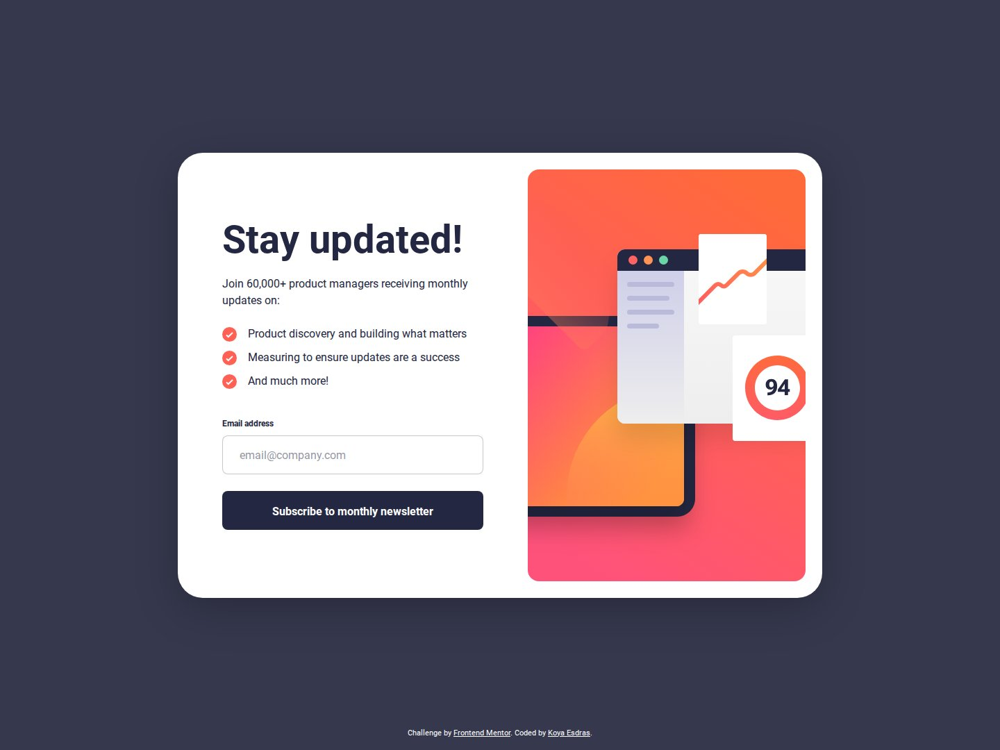

# Frontend Mentor - Newsletter sign-up form with success message solution

This is a solution to the [Newsletter sign-up form with success message challenge on Frontend Mentor](https://www.frontendmentor.io/challenges/newsletter-signup-form-with-success-message-3FC1AZbNrv). Frontend Mentor challenges help you improve your coding skills by building realistic projects.

## Table of contents

- [Overview](#overview)
  - [The challenge](#the-challenge)
  - [Screenshot](#screenshot)
  - [Links](#links)
- [My process](#my-process)
  - [Built with](#built-with)
  - [Workflow](#workflow)
  - [What I learned](#what-i-learned)
  - [Continued development](#continued-development)
  - [Useful resources](#useful-resources)
  - [AI Collaboration](#ai-collaboration)
- [Author](#author)

## Overview

### The challenge

Users should be able to:

- Add their email and submit the form
- See a success message with their email after successfully submitting the form
- See form validation messages if:
  - The field is left empty
  - The email address is not formatted correctly
- View the optimal layout for the interface depending on their device's screen size
- See hover and focus states for all interactive elements on the page

### Screenshot



### Links

- Solution URL: added after submission on Frontend Mentor
- Live Site URL: [ounokoya.github.io/newsletter-signup-form](https://ounokoya.github.io/newsletter-signup-form/)

## My process

### Built with

- Semantic HTML5 markup (`picture`, `form`, `label`, `section`)
- [Tailwind CSS v4](https://tailwindcss.com/) — design tokens declared in `@theme`, default palette removed
- Vanilla JavaScript and the browser's Constraint Validation API
- Mobile-first layout with Flexbox and CSS Grid (mobile < 640 px, tablet 640–1023 px, desktop ≥ 1024 px)
- [Vite](https://vite.dev/) for the build, deployed on GitHub Pages with GitHub Actions
- [Playwright](https://playwright.dev/), [axe-core](https://github.com/dequelabs/axe-core) and the W3C Nu validator for tests

### Workflow

Before any code, the design was analysed and rebuilt:

1. **Visual analysis in Excalidraw** — every screen measured in px (spacing, font sizes, colours, states) → [`specs/visuel/`](./specs/visuel/)
2. **Penpot mockup and prototype** — colour and type library, components with their states, 10 screens, click-through prototype → [`specs/visuel/penpot/`](./specs/visuel/penpot/)
3. **Spec and decisions** — expected behaviour, accessibility contracts, 14 Given/When/Then scenarios → [`specs/specifications/`](./specs/specifications/), architecture decisions → [`specs/adr/`](./specs/adr/)
4. **Code, then tests** — 31 automated tests run against the production build (`npm test`)

### What I learned

**Styling validation states from ARIA attributes.** The error state lives in the DOM, so the styles and the screen reader stay in sync:

```html
<input id="email" type="email" required aria-describedby="email-error"
  class="border-grey/50 aria-invalid:border-red aria-invalid:bg-red/15 aria-invalid:text-red-text">
```

**Letting the browser validate the email.** With `novalidate` on the form, `checkValidity()` still applies the HTML email rule, but my own message is shown instead of the browser bubble:

```js
email.value = email.value.trim()
if (!email.checkValidity()) {
  email.setAttribute('aria-invalid', 'true')
  error.textContent = 'Valid email required'
}
```

**Keeping only the design's colours in Tailwind v4.** Resetting the palette makes any colour that is not in the design fail to compile:

```css
@theme {
  --color-*: initial;
  --color-red: hsl(4 100% 67%);
  --color-blue-800: hsl(234 29% 20%);
}
```

### Continued development

- **Accessibility vs. pixel-perfect.** The design's red error text has a contrast of 2.9:1 (WCAG AA asks 4.5:1), so the error text uses a darker red, `hsl(4, 100%, 42%)`. Two design choices were kept on purpose and are still below WCAG thresholds: white text on the hover gradient (2.8–3.1:1) and the input border (1.6:1, where 3:1 is expected for UI components).
- **Visual comparison with the design files.** Screenshots differ from the Frontend Mentor JPGs by 0.7–3.7 % of pixels, except the mobile form (5.8 %, accepted threshold 6 %): positions match within 1 px, but the JPG was rendered from a slightly different illustration and with a different font smoothing.
- **No tablet design** was provided: the tablet layout (centred card with the tablet illustration) is my own proposal.

### Useful resources

- [MDN — Client-side form validation](https://developer.mozilla.org/en-US/docs/Learn_web_development/Extensions/Forms/Form_validation) — how `checkValidity()` and `novalidate` work together.
- [Tailwind CSS — Theme variables](https://tailwindcss.com/docs/theme) — `@theme`, namespaces and resetting the default palette.
- [WebAIM — Contrast checker](https://webaim.org/resources/contrastchecker/) — to check the error and hover colours.

### AI Collaboration

I used **Claude (Claude Code)** as a pair, inside a spec-driven workflow where I validated each step before the next one:

- **Planning**: choosing the challenge and writing the plan, which I validated.
- **Design analysis**: measuring the JPG designs and drawing the annotated Excalidraw analysis, which I reviewed and validated.
- **Mockup**: building the Penpot library, components, screens and prototype, which I validated.
- **Code and tests**: writing the HTML, Tailwind and JavaScript from the validated spec, plus the Playwright tests.

What worked well: no code was written before the analysis and the mockup were validated, so the layout matched the design on the first build. What needed my decisions: the design's contrast issues, the missing tablet layout and the accepted visual difference on mobile.

## Author

- Frontend Mentor - [@ounokoya](https://www.frontendmentor.io/profile/ounokoya)
- GitHub - [@ounokoya](https://github.com/ounokoya)
